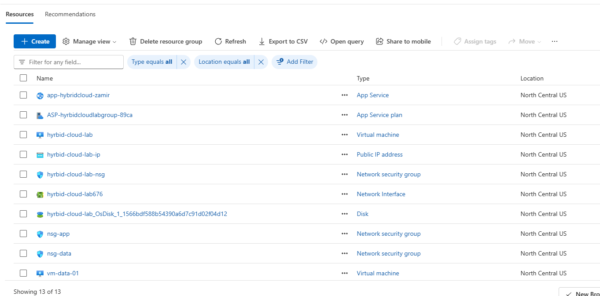

# Architecture

The environment follows a basic 3-tier design with separate web, application, and data layers.

Traffic follows this path:

Internet → Web VM → App Service → PostgreSQL VM

The web tier runs Nginx on an Ubuntu VM and handles traffic coming into the environment.

The application tier uses Azure App Service for the backend. I used App Service instead of another VM so the project would include both IaaS and PaaS instead of relying on virtual machines for everything.

PostgreSQL runs on a separate Ubuntu VM in the data subnet. I originally wanted to use Azure Database for PostgreSQL, but my Azure student subscription would not let me deploy it in the same region as the rest of the lab. The available regions were mostly outside the US, so I decided to keep the database with the rest of the environment and manage PostgreSQL myself on a VM.

The web server does not connect directly to the database. Database traffic goes through the application tier, which keeps the roles separated and gives me more control over what each part of the environment can access.
