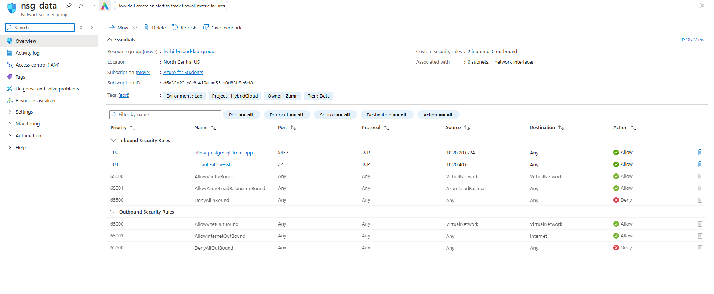

# Network Security

The network rules are based on only giving each tier the access it actually needs.

The web VM accepts normal web traffic through HTTP and HTTPS. SSH access is restricted instead of being open to any source.

The PostgreSQL VM does not have a public IP because nothing on the internet should connect directly to the database.

PostgreSQL uses TCP port 5432. That traffic is allowed from the application subnet so App Service can reach the database.

The web tier does not need direct database access, so there is no rule allowing it.

SSH access to the data tier is tied to the management network rather than being opened broadly.

Anything that does not match an allowed inbound rule falls through to Azure's default deny rule.

Microsoft Defender for Cloud is also enabled so I can review Azure's security recommendations alongside the controls I configure myself.
