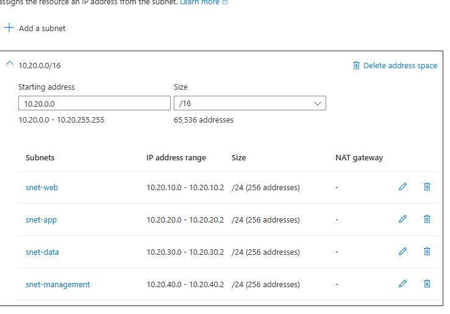

# Networking

The Azure VNet uses the 10.20.0.0/16 address space.

My pfSense homelab already uses networks in the 192.168.x.x range, so I used a different range for Azure. I plan on connecting the two later in the project so using different addresses will make that easier down the line.
The VNet is split into four subnets:

snet-app is delegated to Microsoft.Web/serverFarms so Azure App Service can use VNet Integration.

I originally planned to deploy a management VM in snet-management, but I hit the VM quota on my Azure student subscription. I still plan on using the subnet later.
